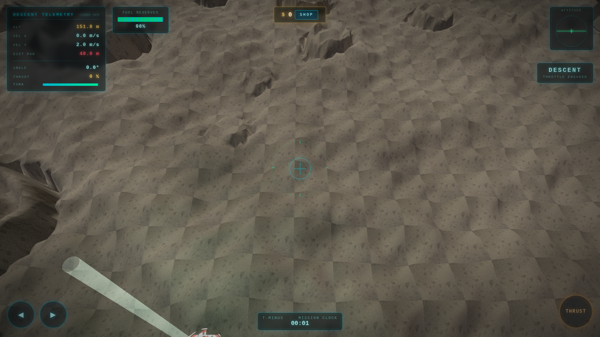
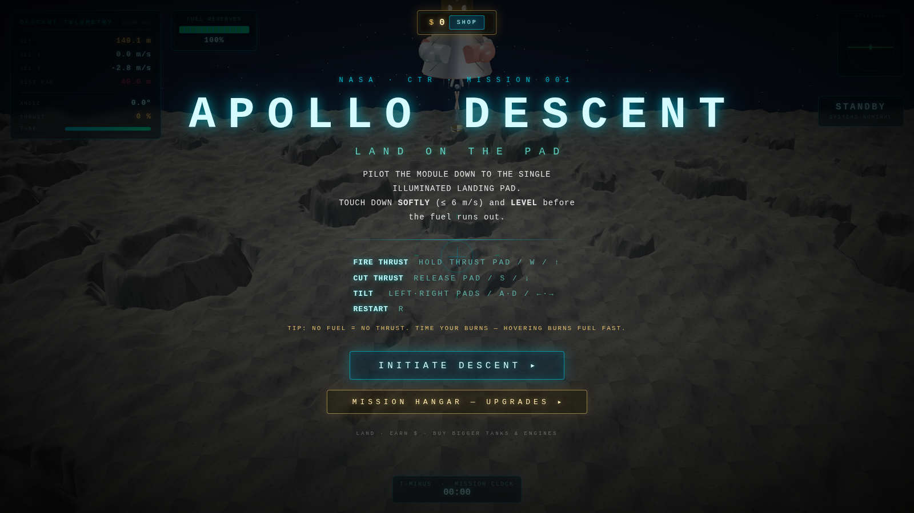
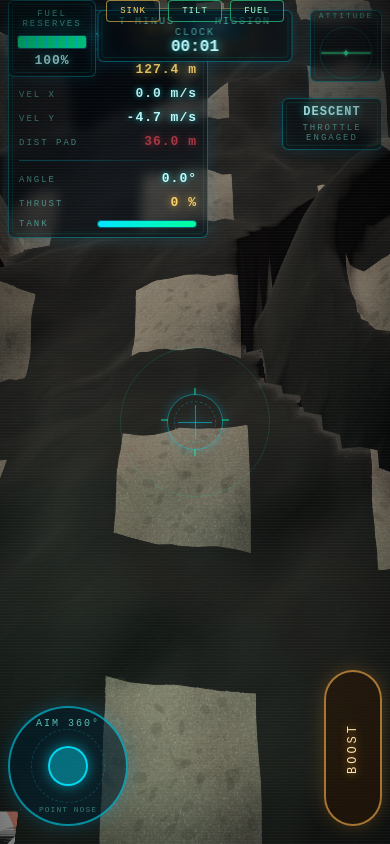

# Apollo Descent — Gravity Lander



A phone-first 3D lunar lander in the browser — thrust, shop, and soft landings.

## At a glance

| | |
|---|---|
| **What it is** | A Three.js gravity-lander game tuned for desktop **and** iPhone Safari. |
| **What it’s for** | A playable lander loop you can open on your phone or laptop. |
| **How to use it** | `./setup.sh` → **http://127.0.0.1:8070/** (or open `index.html`). |

## Try it

### One command
```bash
git clone https://github.com/Coinupbtc/gravity-lander.git
cd gravity-lander && ./setup.sh
```

### Copy-paste
```bash
./setup.sh
# open http://127.0.0.1:8070/
```

### One click
Open `index.html` directly (desktop), or **[the GitHub Pages build](https://coinupbtc.github.io/gravity-lander/)**. For iPhone on LAN, use `./setup.sh` / `serve.py` so assets resolve cleanly.

## Controls

- **Thrust / steer** — on-screen pads on phone; keyboard on desktop.
- Land soft, spend in the shop, go again.

## Notes

- Portrait **390×844** is the primary phone frame; landscape layout is supported.
- `serve.py` sends `no-store` for `index.html` so phone caches don’t stick on stale builds.




